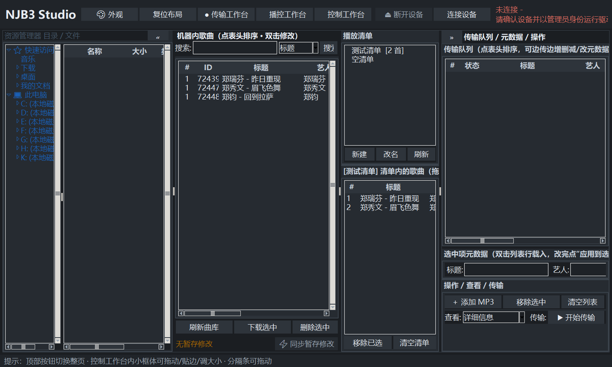
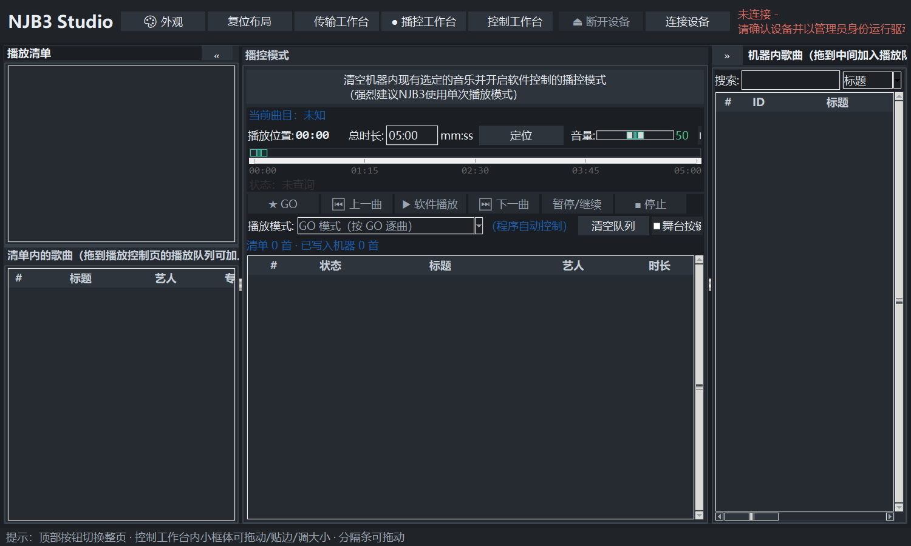
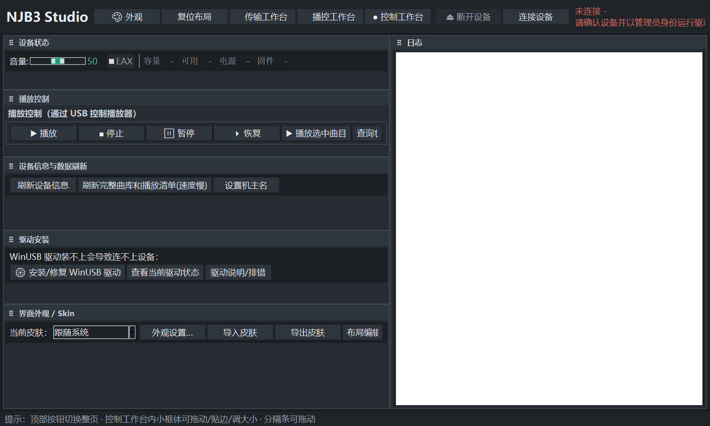

# NJB3 Studio

> 让 **Creative Nomad Jukebox 3**（NJB3，20/40/60 GB 硬盘式 MP3 播放器）在 Windows 10/11 上继续可用：
> 自行实现 WinUSB 驱动绑定与 PDE 私有协议，提供传歌、曲库管理、播放列表与播放控制的一体化桌面软件。

NJB3 不是 U 盘，它使用私有 PDE 协议与主机通信。原厂 CMS5 在 Win11 上无法正确识别设备，
本项目不依赖 CMS5：从 USB 描述符与协议帧入手，自研协议栈与图形界面，最终交付**免安装的单文件绿色程序**。

### 界面预览

| 传输工作台 | 播控工作台 | 控制工作台 |
|---|---|---|
|  |  |  |

---

## 功能一览

- **驱动**：自带 WinUSB 绑定 INF + 自签名 CAT 生成与安装脚本，替换独占端点的 Creative 内核驱动。
- **协议**：自研 `njb3_pde.py`，实现 CBSU 帧、capture/release、UCS-2BE 字符串、曲库与播放列表 CRUD。
- **传歌**：批量上传 MP3，读取/写入 ID3，m3u 与文件夹映射为播放列表，删除/下载/改名/元数据编辑。
- **曲库**：4827+ 首曲目的分批读取、搜索、排序、单元格暂存与批量同步；按设备序号缓存慢字段，连接快读约 17 倍。
- **播放控制**：设备播放队列读取与拖拽排序、音量/播放模式、上一曲/下一曲、软件播控模式与曲终自动停止。
- **界面**：三个整页工作台（传输 / 播控 / 控制）、可停靠模块化布局、深浅双主题与系统主题跟随。
- **可测试**：19 套回归测试、真机诊断脚本一并开源。

---

## 快速开始（绿色版）

1. 从仓库 [releases/](releases/) 目录（或 GitHub Releases 页面）下载 `njb3-studio-0.1.0-261123-win-x64.zip`，解压到任意目录。
2. 双击 `启动 NJB3 Studio.bat`。首次使用需以管理员身份安装一次 WinUSB 驱动：
   右键 `安装 WinUSB 驱动.bat` → **以管理员身份运行**，按提示完成后重新插拔设备。
3. 连接 NJB3，软件会自动识别设备并加载曲库。

程序为 **PyInstaller 单文件**，无需安装 Python；`libusb-1.0.dll` 已内置。
首次连接某台机器需完整读取曲库（约 1 分钟，4827 首），之后走本地缓存约 3 秒。
设备曲库有增删后，点「刷新完整曲库和播放清单(速度慢)」手动同步一次即可。

> 详细操作见 [docs/使用说明.md](docs/使用说明.md)；驱动排错见 [docs/驱动安装与排错.md](docs/驱动安装与排错.md)。

---

## 从源码运行 / 构建

需要 Python 3.13（64 位 Windows）、`pyusb`、`libusb-package`、`pillow`、`pyinstaller`。

```powershell
pip install -r src/scripts/requirements.txt
python src/ui_next/njb3_studio.py          # 直接运行
python -m PyInstaller src/ui_next/njb3_studio.spec --distpath dist --workpath build
```

源码目录刻意保持 `src/ui_next` 与 `src/scripts` 平级，因为程序按相对路径复用业务模块。
完整说明见 [docs/构建与开发.md](docs/构建与开发.md)。

---

## 文档导航

| 文档 | 内容 |
|---|---|
| [docs/使用说明.md](docs/使用说明.md) | 界面、按钮、操作流程与常见问题 |
| [docs/驱动安装与排错.md](docs/驱动安装与排错.md) | WinUSB 驱动安装、签名证书、错误码与排查 |
| [docs/USB接口指令清单.md](docs/USB接口指令清单.md) | 已确认/推测的 PDE 指令码、帧格式与读写语义 |
| [docs/ARCHITECTURE.md](docs/ARCHITECTURE.md) | 代码结构、模块职责与关键设计决策 |
| [docs/AI_DEVELOPMENT_JOURNEY.md](docs/AI_DEVELOPMENT_JOURNEY.md) | AI 辅助开发的完整学习过程：路线、突破、踩坑与实测结论 |
| [docs/01_硬件与协议分析.md](docs/01_硬件与协议分析.md) | 硬件架构与协议分析（含证据） |
| [docs/02_Win11驱动与传输方案.md](docs/02_Win11驱动与传输方案.md) | 驱动与传输方案 |
| [docs/03_易驱线与固件可行性.md](docs/03_易驱线与固件可行性.md) | 易驱线直读、固件升级等可行性论证 |
| [docs/04_驱动与软件安装包.md](docs/04_驱动与软件安装包.md) | 驱动包与安装器制作细节 |
| [docs/05_1394火线卡适配说明.md](docs/05_1394火线卡适配说明.md) | IEEE-1394 备用路线 |
| [docs/06_技术选型与底层重构方案.md](docs/06_技术选型与底层重构方案.md) | 技术栈选型评审 |
| [docs/新版UI说明.md](docs/新版UI说明.md) | 新版 UI 各版本逐项变更与视觉设计系统 |
| [CHANGELOG.md](CHANGELOG.md) | 版本变更摘要 |
| [CONTRIBUTING.md](CONTRIBUTING.md) | 开发约定、测试与版本同步规范 |
| [PUBLISHING.md](PUBLISHING.md) | 首次发布到 GitHub、上传 Release 与自检步骤 |

---

## 目录结构

```
.
├── releases/              绿色发布包（zip + 单文件 exe）
├── src/
│   ├── ui_next/           新版工作台 UI（StudioApp / Dock / Theme / 打包配置）
│   ├── scripts/           业务与协议源码（GUI / PDE / 驱动脚本）
│   └── runtime/           libusb-1.0.dll（LGPL-2.1，随构建打包）
├── tests/                 19 套回归测试
├── tools/diagnostics/     真机只读诊断脚本（播放时序、传输耗时、缓存验证）
├── examples/playlists/    m3u 与文件夹结构示例
└── docs/                  文档与开发学习过程
```

---

## 许可与声明

- 本项目自研代码采用 [GNU GPL v3](LICENSE)：可以自由修改、再开发、商用，但**分发衍生作品时必须同样以 GPL v3 开源**，
  不能把修改后的版本闭源独占。第三方组件（pyusb / libusb / Python / PyInstaller 等）
  版权归各自作者，见 [docs/THIRD_PARTY.md](docs/THIRD_PARTY.md)。
- 本项目用于对**自有设备**的互操作性维护与功能恢复，请勿用于任何侵权用途。
- 项目不分发 Creative 公司的专有驱动、固件、CMS5 软件或受版权保护的手册/数据手册全文；
  相关分析结论均以公开资料与自有设备实测为依据。
- 自签名证书仅用于本机测试驱动安装，请勿用于其他用途。

### GPL v3 对你意味着什么

- **随便改、随便用**：学习、二次开发、自己公司内部使用、甚至商用收费都允许。
- **分发要开源**：如果把修改版发给别人（无论收不收费），必须提供完整源码，并同样以 GPL v3 发布。
- **不能闭源独占**：这意味着没人能把你的改进藏起来变成专有软件，你的成果始终对社区开放。

---

## 致谢

- [libnjb](https://github.com/libnjb/libnjb)：PDE 协议的开源参考实现，本项目的协议理解基础。
- [pyusb](https://github.com/pyusb/pyusb) / [libusb](https://libusb.info/)：用户态 USB 访问。
- [PyInstaller](https://pyinstaller.org/)：单文件绿色打包。
- 以及所有在真机联调中提供反馈与耐心等待的用户。
